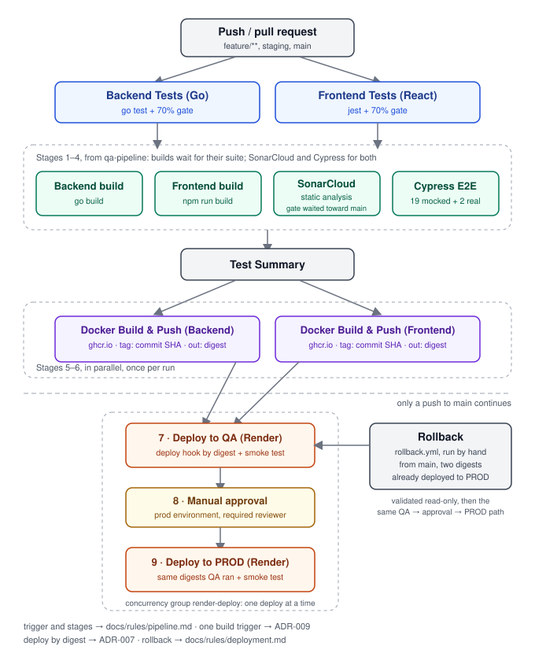
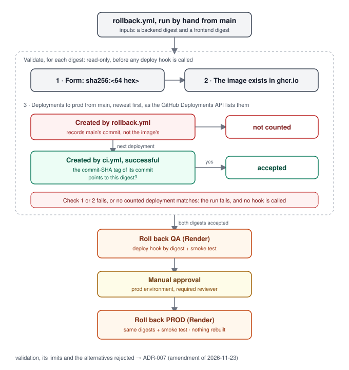

# Forum App — Cloud Deploy

This repository takes the pipeline of the previous two to deployment. Every run executes the tests and quality checks and builds each image once, publishing it to ghcr.io tagged with its commit SHA. On `main`, that run deploys the image by digest to QA and smoke-tests it, waits for manual approval, and deploys the same digest to PROD. A rollback redeploys digests that already reached PROD, through the same path. The runs, digests and deployments that show each step are in the [execution record of 2026-11-24](docs/audits/2026-11-24-execution-record.md). The series was built over three of the course's assignments and audited afterwards; what was found while building and auditing it, and how each finding was corrected, is in [`docs/errors-and-lessons.md`](docs/errors-and-lessons.md).

> **Series.** This is the third of three repositories: [ci-testing](https://github.com/CarpinetiOctavio/forum-app-ci-testing) → [qa-pipeline](https://github.com/CarpinetiOctavio/forum-app-qa-pipeline) → **cloud-deploy**. The split follows the course's assignments (TP6, TP7, TP8 of Software Engineering III, UCC); in practice it would be one repository with tags.

Reading paths: in 30 seconds, the opening paragraph; in five minutes, "What this series shows", "Limitations" and "Errors and lessons"; in depth, [`docs/errors-and-lessons.md`](docs/errors-and-lessons.md) and the decision records each point links. The rest is reference.

## Status

- Closed at `v1.0.0`.
- This repository started as a copy of `forum-app-qa-pipeline@v1.0.0`, after an audit of the original TP8 submission, which is preserved, archived, at [`forum-app-cloud-deploy-legacy`](https://github.com/CarpinetiOctavio/forum-app-cloud-deploy-legacy) ([ADR-000](docs/decisions/ADR-000-starting-from-qa-pipeline-v1.0.0.md); the audits are in [`docs/audits/`](docs/audits/)).
- TP6 and TP7 were submitted in October 2025 ([ci-testing](https://github.com/CarpinetiOctavio/forum-app-ci-testing), [qa-pipeline-legacy](https://github.com/CarpinetiOctavio/forum-app-qa-pipeline-legacy)); TP8 was built in June and July 2026, and `-legacy`'s history starts on 2026-06-24. `-legacy`'s README says "Year: 2025", against its own banner, which says July 2026; `-legacy` is not modified.
- `CLAUDE.md` and [`docs/rules/`](docs/rules/) are operating instructions for an AI assistant working in this repository, not project documentation.

## How it works

Triggers and one build per run: [ADR-009](docs/decisions/ADR-009-single-build-trigger.md). Deploy by digest: [ADR-007](docs/decisions/ADR-007-render-deploy-mechanism.md), amendment of 2026-11-11.

The validation, its limits and the alternatives rejected: [ADR-007](docs/decisions/ADR-007-render-deploy-mechanism.md), amendment of 2026-11-23.

## What this series shows

1. **Mocks stand exactly at the I/O boundary** ([ci-testing](https://github.com/CarpinetiOctavio/forum-app-ci-testing)). Repositories and `axios` are replaced, and the unit's own logic runs for real: mocking the unit itself would make the test tautological, and a real database would make it an integration test ([ADR-003](https://github.com/CarpinetiOctavio/forum-app-ci-testing/blob/main/docs/decisions/ADR-003-mocking-strategy.md)).
2. **The ruleset is the gate** ([ci-testing](https://github.com/CarpinetiOctavio/forum-app-ci-testing)). `staging` and `main` require a pull request, with no bypass, so the push trigger on those branches runs only on the merge commit a pull request produces ([ADR-004](https://github.com/CarpinetiOctavio/forum-app-qa-pipeline/blob/main/docs/decisions/ADR-004-pipeline-extension.md), amendment of 2026-11-12). Here the nine required checks include both Docker builds, so an image that fails to build blocks the merge instead of failing in the run that deploys ([execution record](docs/audits/2026-11-24-execution-record.md), section 4; [screenshot 01](docs/screenshots/01-docker-checks-required.png)).
3. **A 70% coverage gate, measured only where the business rules live** ([qa-pipeline](https://github.com/CarpinetiOctavio/forum-app-qa-pipeline)). Services in the backend, components and services in the frontend: 100% would reward tests written for the number, and measuring wiring and type definitions would make the percentage say nothing ([ADR-001](https://github.com/CarpinetiOctavio/forum-app-qa-pipeline/blob/main/docs/decisions/ADR-001-coverage-strategy.md)).
4. **SonarCloud's quality gate is waited for only on the path to `main`** ([qa-pipeline](https://github.com/CarpinetiOctavio/forum-app-qa-pipeline), adopted here). The Free plan has a gate only for `main` and for pull requests into it, and waiting for it on another branch fails the job ([ADR-002](https://github.com/CarpinetiOctavio/forum-app-qa-pipeline/blob/main/docs/decisions/ADR-002-sonarcloud.md), amendment of 2026-11-12; [ADR-009](docs/decisions/ADR-009-single-build-trigger.md), amendment of 2026-11-23).
5. **Cypress against mocked responses, except where a mock would hide the rule** ([qa-pipeline](https://github.com/CarpinetiOctavio/forum-app-qa-pipeline)). `DeleteComment` checks authorship in a SQL `WHERE` clause that a mocked response cannot reach, so its tests run against the real backend and SQLite ([ADR-003](https://github.com/CarpinetiOctavio/forum-app-qa-pipeline/blob/main/docs/decisions/ADR-003-cypress.md)).
6. **The slow gates run after the fast ones** ([qa-pipeline](https://github.com/CarpinetiOctavio/forum-app-qa-pipeline)). SonarCloud and Cypress wait for the unit tests, in parallel with each other: a failing unit test stops the run before static analysis and E2E spend time on it ([ADR-004](https://github.com/CarpinetiOctavio/forum-app-qa-pipeline/blob/main/docs/decisions/ADR-004-pipeline-extension.md)).
7. **One build per run, and QA and PROD from the same run on `main`** (this repository). With `staging` deploying to QA and `main` to PROD, each branch would build its own image, and PROD would run one that QA never tested ([ADR-009](docs/decisions/ADR-009-single-build-trigger.md)).
8. **Each credential is the narrowest available** (this repository). `GITHUB_TOKEN` has `packages: write` only in the two jobs that push ([ADR-002](docs/decisions/ADR-002-container-registry.md), amendment of 2026-11-24). Each Render service has its own deploy hook, which can only redeploy that service's image. The Render API key, which Render scopes to the whole account, is used only for `GET` calls, a restriction this pipeline's code enforces, not Render ([ADR-007](docs/decisions/ADR-007-render-deploy-mechanism.md)).
9. **The SHA tag traces; the digest deploys** (this repository). Builds are not reproducible, so a rerun pushes a different image under the same tag; deploys pass the digest, which cannot move ([ADR-003](docs/decisions/ADR-003-image-tagging.md), amendment of 2026-11-23; [ADR-007](docs/decisions/ADR-007-render-deploy-mechanism.md), amendment of 2026-11-11).
10. **One frontend image for QA and PROD** (this repository). The backend URL is substituted into the built bundle when the container starts; one image per environment would put in PROD an image QA never ran ([ADR-006](docs/decisions/ADR-006-frontend-runtime-config.md)).
11. **Rollback by digest, through the pipeline's own path** (this repository). It validates digests already deployed to PROD from `main`, then deploys them to QA and, after approval, to PROD, without rebuilding. Render's dashboard rollback was rejected: it skips the PROD approval and leaves no record of the digest ([ADR-007](docs/decisions/ADR-007-render-deploy-mechanism.md), amendment of 2026-11-23).

## Limitations

- **Authentication can be spoofed.** The app trusts a client-supplied `X-User-ID` header, and QA and PROD carry that design; authentication is outside the series' scope ([ADR-001](docs/decisions/ADR-001-real-authentication-in-scope.md), amendment of 2026-11-11).
- **What is tested is not exactly what ships.** Cypress runs against the development server, not the nginx image ([ADR-010](docs/decisions/ADR-010-cypress-frontend-wait.md)); the frontend smoke test checks that the deployed bundle carries its environment's backend URL ([`smoke-test.sh`](.github/scripts/smoke-test.sh)), and nothing checks that the deployed frontend reaches its backend.
- **PROD is a demonstration,** with ephemeral data, not a service for real users ([ADR-001](docs/decisions/ADR-001-real-authentication-in-scope.md), amendment of 2026-11-11).
- **No gate checks commits for Render keys.** A check that runs after the push finds a key already published, so it would not prevent the exposure; the case that led to this is in [`docs/errors-and-lessons.md`](docs/errors-and-lessons.md#a-mechanism-that-did-not-do-what-was-stated).
- **The pipeline depends on GitHub's hosted runner.** Its runtime changed under a pinned action and broke the Cypress wait; the fix reduces that exposure, it does not remove it ([ADR-010](docs/decisions/ADR-010-cypress-frontend-wait.md)).
- **The PROD gate is one person's pause.** Its only required reviewer is the repository's owner ([`SETUP.md`](docs/SETUP.md); [screenshot 05](docs/screenshots/05-prod-approval-run-45336308644.png)): it holds a deploy until it is approved, but no second person reviews it.
- **The SonarCloud gate applies only on the path to `main`,** and a SonarCloud outage blocks merges into `main` ([ADR-002](https://github.com/CarpinetiOctavio/forum-app-qa-pipeline/blob/main/docs/decisions/ADR-002-sonarcloud.md) of qa-pipeline, amendment of 2026-11-12; [ADR-009](docs/decisions/ADR-009-single-build-trigger.md), amendment of 2026-11-23).
- **The rollback check has limits** ([ADR-007](docs/decisions/ADR-007-render-deploy-mechanism.md), amendments of 2026-11-23 and 2026-11-24). It proves that a digest's commit reached PROD, not that the digest did. A rollback's deployments record the commit of `main` at the time, not the commit of the image. A newer pending deploy replaces an older pending one. A PROD deploy waiting for approval holds the deploy group; whether a rejection or the 30-day expiry releases it was not observed.
- **The database is ephemeral** ([ADR-005](docs/decisions/ADR-005-sqlite-persistence.md)). Every deploy, rollback included, starts it empty. On Render's Free plan a service also spins down after 15 minutes without traffic, takes about a minute to come back, may be restarted by Render at any time, and loses its local files whenever it redeploys, restarts or spins down ([Render, Free instances](https://render.com/docs/free), consulted 2026-11-25).

## Errors and lessons

[`docs/errors-and-lessons.md`](docs/errors-and-lessons.md) holds the errors of the three stages: what each one was, how it was found and what was corrected. They are grouped in four patterns:

- [A document said something the pipeline did not do](docs/errors-and-lessons.md#a-document-said-something-the-pipeline-did-not-do): the trigger is stated in one place, `ci.yml` and its ADR, and linked from the rest.
- [A number or fact that was not checked](docs/errors-and-lessons.md#a-number-or-fact-that-was-not-checked): a number a machine produces is linked to its source, not restated.
- [A mechanism that did not do what was stated](docs/errors-and-lessons.md#a-mechanism-that-did-not-do-what-was-stated): pinning an action does not pin the environment it runs on, and a syntax check is not a behavior check.
- [A pipeline dependency out of support](docs/errors-and-lessons.md#a-pipeline-dependency-out-of-support).

## Evidence

The [execution record of 2026-11-24](docs/audits/2026-11-24-execution-record.md) lists the runs, digests and deployments, and is not updated. GitHub keeps Actions logs for 90 days; the captures in [`docs/screenshots/`](docs/screenshots/README.md) remain after that, each with what to look at:

- **Pipeline:** both Docker builds as required checks, two digests from identical trees, the run on `main` and the PROD approval.
- **Rollback:** a malformed input rejected, the three rollbacks, the validation that counts only deployments created by `ci.yml`, and a PROD job waiting for approval that holds the deploy group ([diagram](docs/diagrams/rollback.svg); [ADR-007](docs/decisions/ADR-007-render-deploy-mechanism.md)).
- **Quality gate:** a red gate blocking a pull request into `main`.

## Decisions

Every decision, with its alternatives and later amendments, is in [`docs/decisions/`](docs/decisions/README.md); its index lists each record with one line on what it decides.

## Running it

What a copy of this repository needs, from GitHub, ghcr.io, SonarCloud and Render, is in [`docs/SETUP.md`](docs/SETUP.md); the commands, rollback included, are in [`docs/COMMANDS.md`](docs/COMMANDS.md).

## AI disclosure

Language models (Claude, in chat sessions and through Claude Code) were used to audit the repository, check claims against it, and write text and code. Every design choice was decided by Octavio Carpineti. From commit `d15e749` on, every commit other than a merge commit carries a `Co-Authored-By` trailer for that use; the two earlier commits, `7ca7078` and `c179a1b`, do not.

## License

MIT ([LICENSE](LICENSE)).
