# Screenshots

GitHub keeps Actions logs for 90 days; these captures are the record after that. Each one states what to look at and which decision it supports. The runs they show are listed, with their IDs and times, in the [execution record of 2026-11-24](../audits/2026-11-24-execution-record.md). Render service IDs are covered in captures 02, 03 and 13.

GitHub numbers the rollback runs "Rollback #1" to "#4" in its interface; #1 is the rejected input of capture 06, so rollbacks 1 to 3 appear as #2 to #4.

## Pipeline

**01 — Both Docker builds are required checks.** Pull request #24: `Docker Build & Push (Backend)` and `(Frontend)` are marked "Required", with the seven inherited checks, so an image that fails to build blocks the merge, instead of failing in the run that deploys ([execution record](../audits/2026-11-24-execution-record.md), section 4).

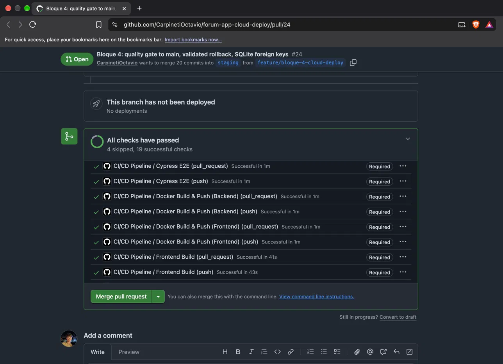

**02 and 03 — Identical trees, different digests.** The PROD deploy of runs `43306631470` (`7ee46bf`) and `43341781168` (`3b158c0`): the two commits have identical `backend/` and `frontend/` trees, and the `Image:` lines show different digests for both images. Builds are not reproducible, so what this repository guarantees is one build per run and the promotion of its digest ([`ADR-009`](../decisions/ADR-009-single-build-trigger.md); [`ADR-007`](../decisions/ADR-007-render-deploy-mechanism.md), amendment of 2026-11-11). Under each `Image:` line, "Digest reported by Render" is the platform manifest inside that image index.

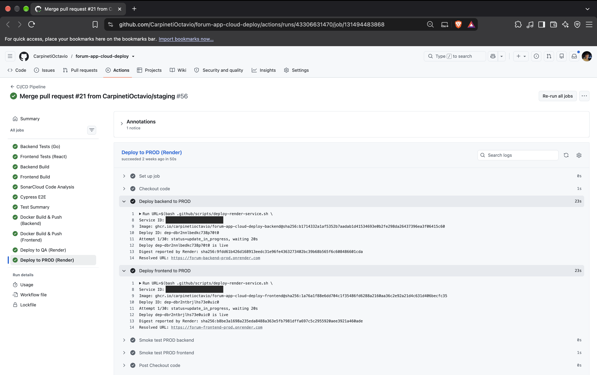

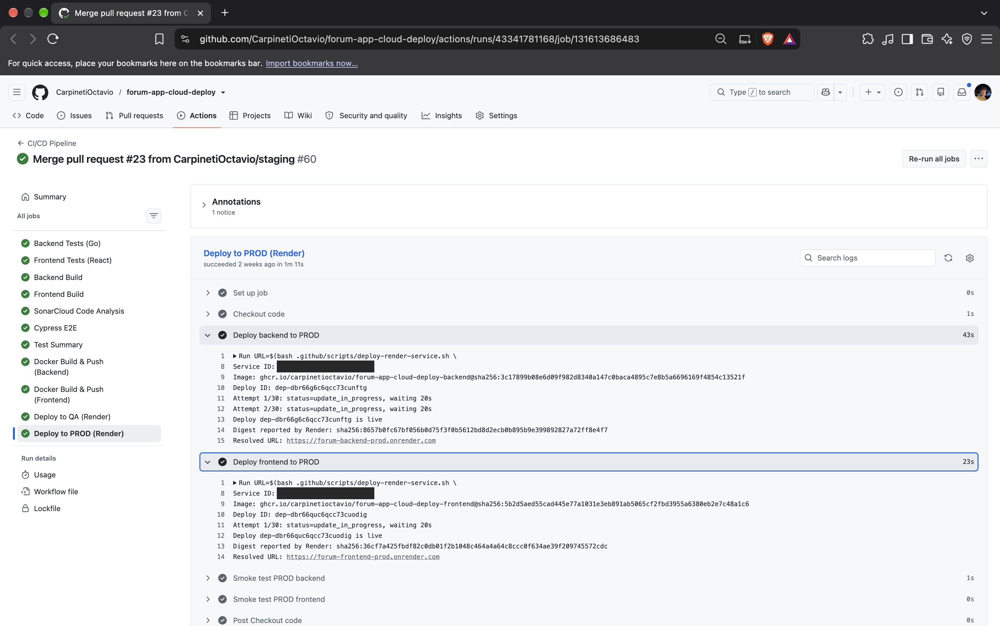

**04 — The pipeline on `main`.** Run `45336308644`, the push of `a14fb88`: tests, quality gate, both builds, QA and PROD, all green ([`ADR-009`](../decisions/ADR-009-single-build-trigger.md)).

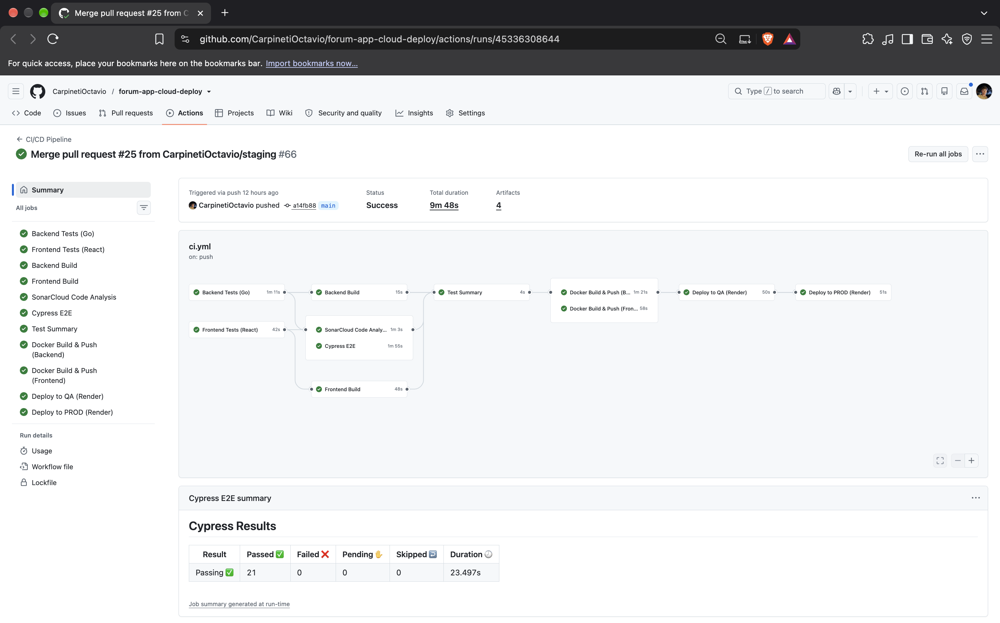

**05 — PROD approval.** The same run: the approval under "Deployment protection rules", whose comment names the digests QA deployed and tested ([`ADR-007`](../decisions/ADR-007-render-deploy-mechanism.md)). The Artifacts table below it lists build records and coverage reports, not images; its digests are those of the artifact archives.

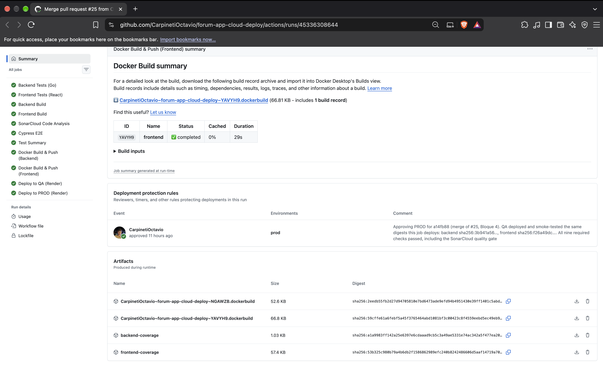

## Rollback

**06 — A malformed input is rejected.** Run `45438714033` was given a commit SHA instead of a digest: the validation fails on the format before any deploy hook is called, and QA and PROD are skipped ([`ADR-007`](../decisions/ADR-007-render-deploy-mechanism.md), amendment of 2026-11-23).

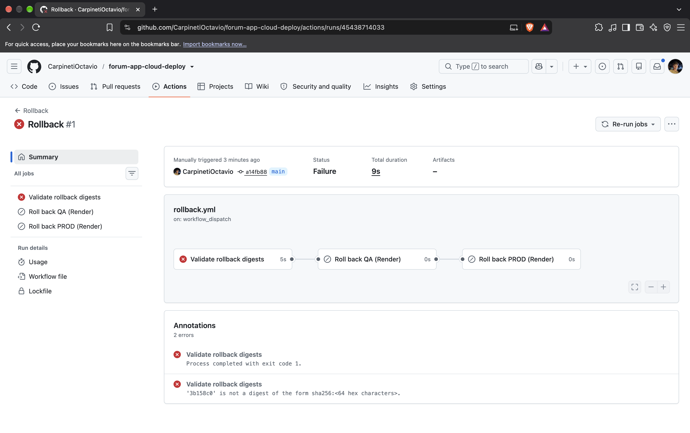

**07 — Rollback 1, to `3b158c0`.** Run `45439653236`: validated, deployed to QA and, after the approval shown, to PROD ([`ADR-007`](../decisions/ADR-007-render-deploy-mechanism.md), amendment of 2026-11-23).

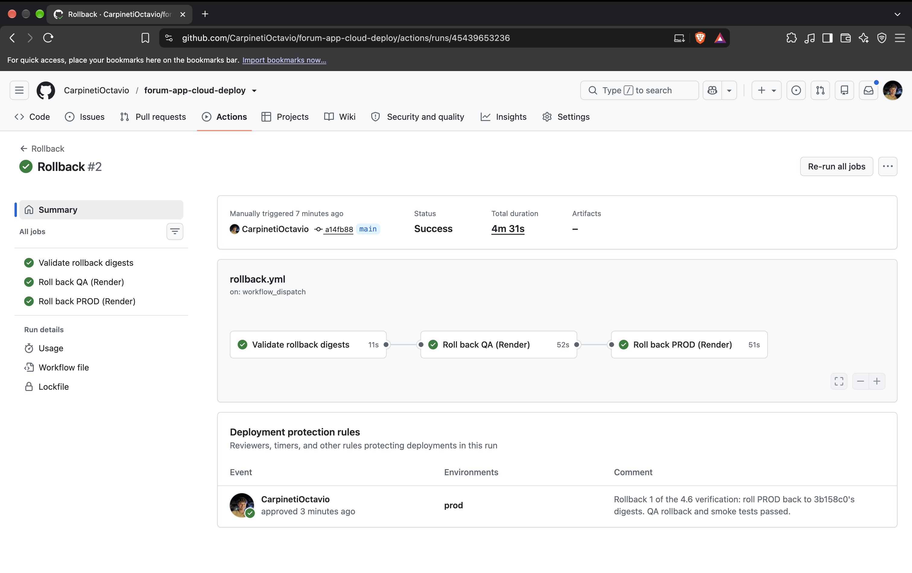

**08 — Only deployments created by `ci.yml` count.** Run `45442208645`, rollback 2: both digests are accepted against deployment `8019972867`, created by the pipeline, although the API listed first a deployment of the same commit created by rollback 1. The skipped deployment is not logged; the list it is read against is in the [execution record](../audits/2026-11-24-execution-record.md), section 3.3. "Require main" is greyed out because it runs only when the workflow was not started from `main`.

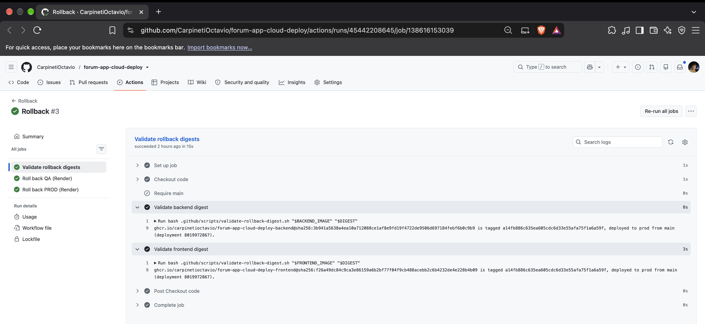

**09 — PROD waits for approval.** Run `45442208645`, rollback 2: QA is done and PROD is "waiting for review" in the `prod` environment.

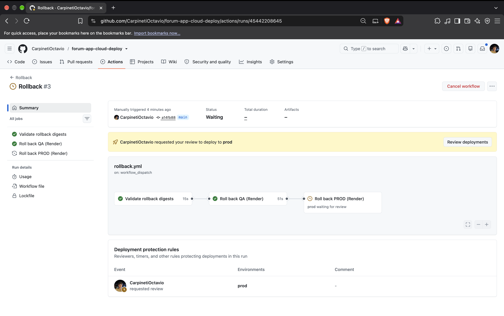

**10 — A PROD job waiting for approval holds the concurrency group.** Rollback 3, run `45442757655`, started while rollback 2's PROD waited: its QA job is pending, and GitHub states that it is waiting for "Roll back PROD (Render) (Rollback #3)" ([`ADR-007`](../decisions/ADR-007-render-deploy-mechanism.md), amendment of 2026-11-24).

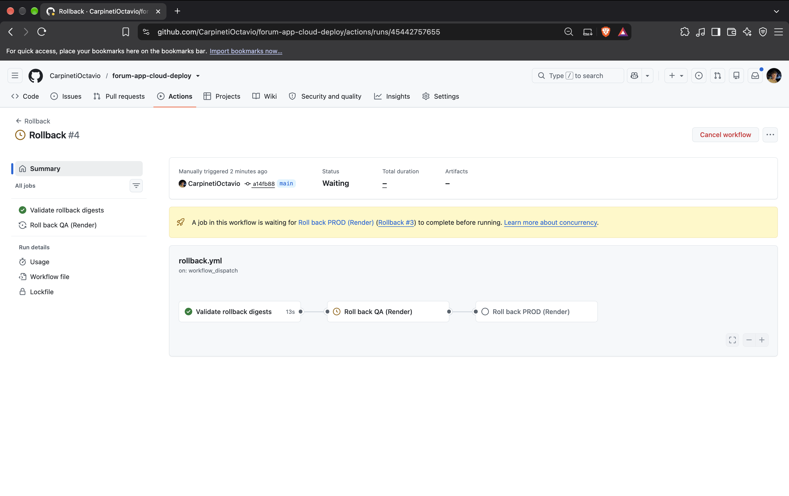

**11 and 12 — Both approvals.** Run `45442208645`, rollback 2, approved after the QA job of run `45442757655`, rollback 3, had been seen waiting; then run `45442757655`, whose QA started 4 s after rollback 2's PROD finished.

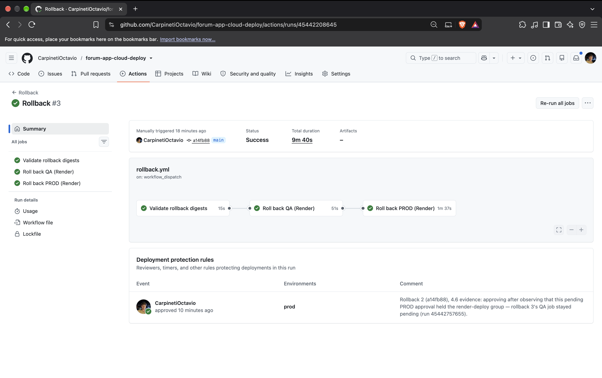

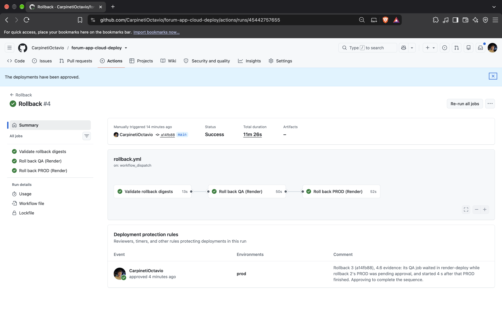

**13 — The same deploys, as Render records them.** The events of `forum-backend-prod`, in local time (UTC−8): the PROD deploys of runs `45439653236`, `45442208645` and `45442757655`, each "Triggered via Deploy Hook", with the image digest the hook passed on the right and the platform manifest Render runs in the title.

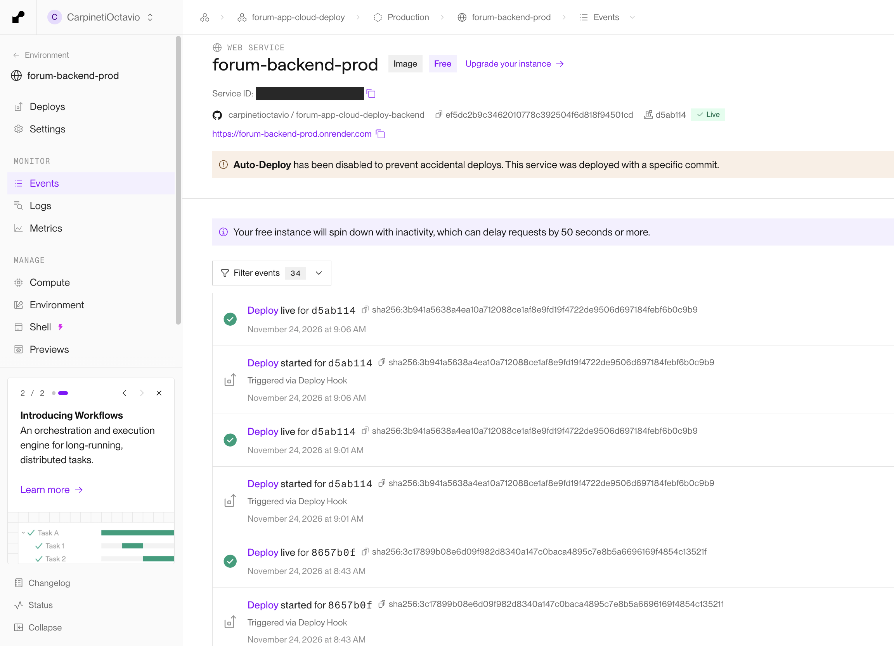

## Quality gate

**14 — A red quality gate blocks a pull request into `main`.** Pull request #26, a disposable probe closed without merging: the gate fails on 0.0% coverage on new code, `SonarCloud Code Analysis` and `Test Summary` fail, the Docker and deploy jobs are skipped, and the merge is blocked ([`ADR-009`](../decisions/ADR-009-single-build-trigger.md), amendment of 2026-11-23).

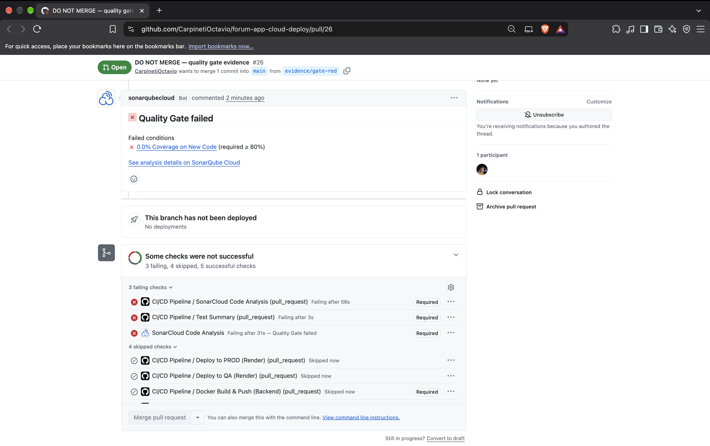
